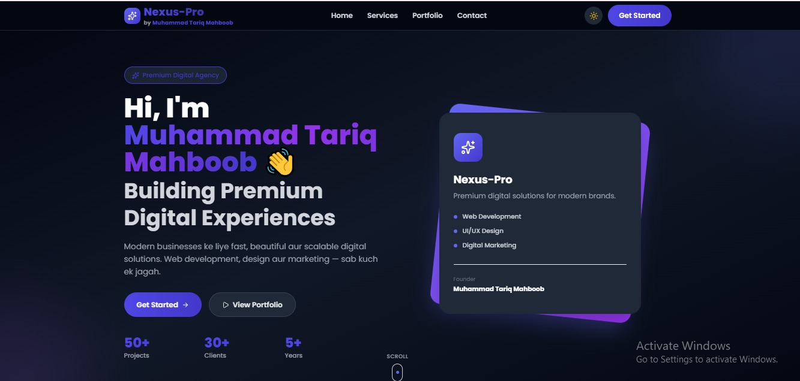

<div align="center">

# 🚀 Nexus-Pro

### 💎 Premium Digital Solutions for Modern Brands

[](https://nexus-pro-sandy.vercel.app)
[](https://github.com/Tariqkhan61/nexus-pro)
[](https://github.com/Tariqkhan61)

<br/>



*(👆 Tip: Apna screenshot upload karke yahan link daal dein)*

</div>

---

## 👋 Hi, I'm Muhammad Tariq Mahboob

**Web Developer & Founder of Nexus-Pro** 👨‍💻

Nexus-Pro is a premium digital agency focused on building fast, beautiful, and scalable digital experiences. We help modern businesses grow by providing top-notch web development, stunning UI/UX design, and result-driven digital marketing — **all in one place.** 🚀

> 🎯 *"Building Premium Digital Experiences for Modern Brands."*

🌐 **Explore the Live Site:** [nexus-pro-sandy.vercel.app](https://nexus-pro-sandy.vercel.app)

---

## ✨ Services We Offer

- 💻 **Web Development** — Fast, responsive, and scalable websites.
- 🎨 **UI/UX Design** — Clean, intuitive, and user-centric interfaces.
- 📈 **Digital Marketing** — Strategies to grow your brand and reach.

---

## 📊 Nexus-Pro by the Numbers

| 🚀 Projects Delivered | 🤝 Happy Clients | 🏆 Years of Experience |
| :---: | :---: | :---: |
| **50+** | **30+** | **5+** |

---

## 🛠️ Tech Stack

Built with modern and industry-standard technologies:

| Frontend | Styling | Deployment | Version Control |
| :--- | :--- | :--- | :--- |
| HTML5, JavaScript, React/Next.js | Tailwind CSS | Vercel | Git & GitHub |

*(✏️ Note: Please update the specific framework if you used something else)*

---

## 🌟 Key Features of the Site

- 🌙 **Immersive Dark Mode** — Sleek and modern UI with glowing purple accents.
- 📱 **100% Responsive** — Looks perfect on mobile, tablet, and desktop.
- ⚡ **Lightning Fast** — Optimized performance for the best user experience.
- 💼 **Dynamic Portfolio** — Showcasing top-tier projects and stats.
- 📬 **Contact Form** — Easy way for clients to get in touch.

---

## 🚀 Run Locally

Want to run this project on your machine? Follow these simple steps:

1. **Clone the repository**
   ```bash
   git clone https://github.com/Tariqkhan61/nexus-pro.git